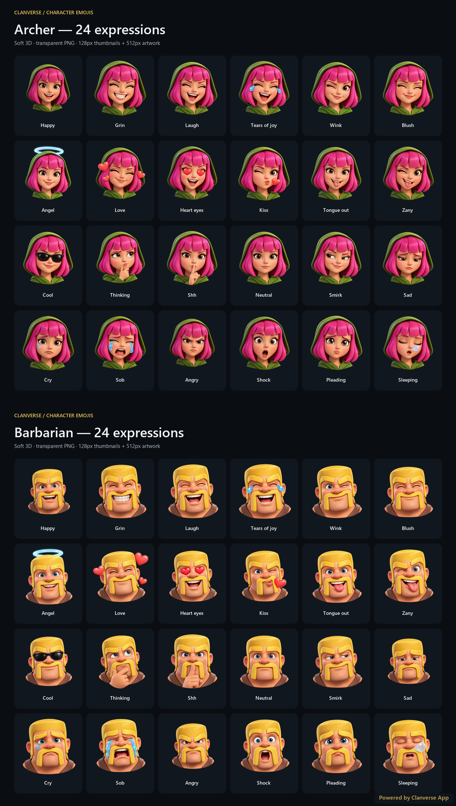

<div align="center">

<h1>
  <picture>
    <source media="(prefers-color-scheme: dark)" srcset="branding/clanverse-logo-dark.svg">
    
  </picture>
  Clanverse App
</h1>

### Bring your clan's conversations to life.

**A dedicated, unofficial fan app for Clash of Clans.**

[](https://clanverse.vercel.app)

[Visit the Clanverse website](https://clanverse.vercel.app)

**Launch status:** Clanverse App is in development and has not launched yet. The current website is [clanverse.vercel.app](https://clanverse.vercel.app). A Google Play download link will be added after the app is published.

*Unofficial fan content. Clanverse App is not endorsed by Supercell.*

---

## Archer & Barbarian Character Emojis

**48 character expressions · transparent PNGs · open-source Python tools**

</div>

This pack provides 24 custom-designed expressions for Archer and the same 24 for Barbarian, in a consistent soft 3D style. Each expression has a preserved master source, a 512 × 512px full export, and a 128 × 128px thumbnail. Artwork was generated with the built-in image generation tool; [prompts.json](prompts.json) records the character references and expression instructions.

The Python utilities are MIT-licensed open-source software. The artwork is available under CC BY-NC 4.0 to the extent the contributor owns the relevant rights. The noncommercial artwork license is not an open-source software license, and it does not grant rights to Supercell's intellectual property. See [License & Disclaimer](#license--disclaimer) before redistribution or integration.



The full source checkout also includes **30 additional stickers** in `troops-and-heroes/`: three comedy poses each for Dragon, Wizard, Hog Rider, and Bowler, plus three heroic poses each for Barbarian King, Archer Queen, Grand Warden, Royal Champion, Minion Prince, and Dragon Duke. That collection has its own README, prompt plan, runtime manifest, transparent exports, preview, and `Clanverse-Troops-Comedy-Heroes-30.zip`. It is packaged separately from the original 48-expression ZIP described below.

## Quick start

Use Python 3.10 or newer. The verified environment is Python 3.12 with Pillow 12.2.0; the only third-party dependency is pinned in [requirements.txt](requirements.txt). The exporter tries Windows, Linux, and macOS system fonts, then falls back to Pillow's built-in font. Font differences can change preview typography without changing runtime artwork.

From this directory, run:

```powershell
python -m pip install -r requirements.txt
python -m unittest -v test_tools
python add_watermark.py
python validate-pack.py --require-masters
python package-pack.py
```

These commands work from `C:\Project\coc-app\assets\clanverse-character-emojis`. You can also invoke each script by absolute path from another working directory. To regenerate all exports from the preserved masters, run `python export-pack.py` before validation and packaging. Exporting overwrites generated files; commit or back up intentional manual edits first. Image generation is separate and is not performed by these utilities.

The runtime ZIP intentionally omits master sources. After extracting it, use `python validate-pack.py` without `--require-masters`. Obtain the complete source folder to regenerate the pack.

## Directory structure

```text
clanverse-character-emojis/
├── README.md                     # Project guide and app promotion
├── LICENSE                       # Single authoritative, scope-based license
├── LICENCE.txt                   # Legacy pointer to LICENSE; no separate terms
├── requirements.txt              # Pillow dependency
├── .gitignore                    # Local caches; makes this README trackable
├── branding/                     # Exact Flutter home-header logo, light/dark SVGs
├── archer/                       # 24 expressions × 3 source/export files
│   ├── 01-happy-master.png        # Original transparent source, native dimensions
│   ├── 01-happy-512.png           # Full runtime artwork
│   ├── 01-happy-128.png           # Picker thumbnail
│   └── ...                       # Through 24-sleep at all three resolutions
├── barbarian/                    # Identical expression IDs and suffix convention
├── expressions.json              # Shared, ordered set of 24 expressions
├── manifest-plan.json            # 48 planned character/expression mappings
├── manifest.json                 # Runtime registry containing both packs
├── archer-pack.json              # Archer entry, identical to its manifest pack
├── barbarian-pack.json           # Barbarian entry, identical to its manifest pack
├── smiley-catalog.json            # Unicode reference catalog (101 entries currently)
├── prompts.json                  # Generation instructions and provenance
├── validation.json               # Export-time dimensions and alpha report
├── state.json                    # Generation completion snapshot
├── archer-preview.png            # Branded root preview map, 1280 × 1130px
├── barbarian-preview.png          # Branded root preview map, 1280 × 1130px
├── complete-preview.png          # Branded combined map, 1280 × 2260px
├── archer-Figma-import.svg        # Review board with embedded PNG artwork
├── barbarian-Figma-import.svg     # Review board with embedded PNG artwork
├── archer-progress.png           # Historical progress board, not a runtime asset
├── barbarian-progress.png        # Historical progress board, not a runtime asset
├── export-pack.py                # Master → runtime exports, registry, review boards
├── add_watermark.py              # Fixed-allowlist preview branding
├── package-pack.py               # Runtime ZIP with licensing and tools
├── read-catalog.py               # Optional Unicode catalog refresh
├── validate-pack.py              # Cross-file mapping and image validation
├── test_tools.py                 # Watermark protection regression tests
└── Clanverse-Archer-Barbarian-48.zip
```

There are **48 logical character assets and 144 PNG source/export files** in the two character directories: 48 masters, 48 full exports, and 48 thumbnails. The current master dimensions are **1254 × 1254px, 1311 × 1200px, and 1312 × 1199px**. Masters are preserved at native size; they are not required to be square. Runtime exports fit the source proportionally into a transparent square using Lanczos resampling, without cropping or stretching.

Recommended display sizes are 32–64px for inline emojis and 96–128px for larger sticker messages. Use the 128px variant in pickers and the 512px variant for full sticker rendering.

## Expression inventory

The same ordered inventory applies to both characters. `halo`, `tongue`, and `sleep` are stable IDs even though their display labels are Angel, Tongue out, and Sleeping.

| No. | Stable ID | Display label | Unicode fallback |
| --- | --- | --- | --- |
| 01 | `happy` | Happy | 😀 |
| 02 | `grin` | Grin | 😁 |
| 03 | `laugh` | Laugh | 😆 |
| 04 | `tears-of-joy` | Tears of joy | 😂 |
| 05 | `wink` | Wink | 😉 |
| 06 | `blush` | Blush | 😊 |
| 07 | `halo` | Angel | 😇 |
| 08 | `love` | Love | 🥰 |
| 09 | `heart-eyes` | Heart eyes | 😍 |
| 10 | `kiss` | Kiss | 😘 |
| 11 | `tongue` | Tongue out | 😛 |
| 12 | `zany` | Zany | 🤪 |
| 13 | `cool` | Cool | 😎 |
| 14 | `thinking` | Thinking | 🤔 |
| 15 | `shh` | Shh | 🤫 |
| 16 | `neutral` | Neutral | 😐 |
| 17 | `smirk` | Smirk | 😏 |
| 18 | `sad` | Sad | 😔 |
| 19 | `cry` | Cry | 😢 |
| 20 | `sob` | Sob | 😭 |
| 21 | `angry` | Angry | 😠 |
| 22 | `shock` | Shock | 😮 |
| 23 | `pleading` | Pleading | 🥺 |
| 24 | `sleep` | Sleeping | 😴 |

## Automation utilities

### Export the asset pipeline

```powershell
python export-pack.py
```

[export-pack.py](export-pack.py) reads [expressions.json](expressions.json) and each character's `NN-expression-master.png`. It verifies nonempty artwork and transparency, writes clean 128px/512px RGBA PNGs, and rebuilds `manifest.json`, both per-character pack files, `validation.json`, `state.json`, both preview PNGs, the combined preview, and the Figma review boards. It then brands only the three completed root preview PNGs. The combined preview is composed from clean in-memory boards, so it gets exactly one corner tag.

The master PNGs, expression definitions, plan, catalog, prompts, and historical progress boards are not rewritten. The JSON printed on success reports the asset count, export sizes, and watermarked filenames. Missing masters or unusable alpha stop the export. This is a sequential utility, not a transactional build; fix a failure and rerun it before publishing.

### Watermark existing previews

```powershell
python add_watermark.py
```

[add_watermark.py](add_watermark.py) adds a small, semi-transparent **Powered by Clanverse App** tag in the bottom-right footer. Its exact allowlist is:

- `complete-preview.png`
- `archer-preview.png`
- `barbarian-preview.png`

There is no recursive search or arbitrary image-path argument. Symlinked previews, paths resolving outside the root, and hard-linked previews are rejected. A `ClanversePreviewWatermark=1` PNG metadata marker prevents repeated overlay stacking. A completed PNG is encoded to a temporary file before replacing its destination. To change branding, regenerate previews from the exporter rather than stripping the marker from an already branded image.

**Every image inside `archer/` and `barbarian/` remains free of watermark overlays and retains its transparent background.** SVG review boards, their embedded artwork, and progress PNGs are outside the watermark rule. Applications should render individual character PNGs rather than crop artwork out of preview boards. Keep required attribution and unofficiality notices in the surrounding app UI or accompanying documentation; clean pixels do not remove those obligations.

### Build the distribution

```powershell
python package-pack.py
```

[package-pack.py](package-pack.py) checks required inputs, applies the allowlisted preview watermark if needed, and creates `Clanverse-Archer-Barbarian-48.zip`. It includes the 96 runtime PNGs, preview maps, SVG review boards, README with its light/dark brand logos, unified LICENSE, dependency file, engineering utilities/tests, and the expression/mapping/catalog/provenance JSON files. It verifies ZIP integrity and exact membership after writing. The current package contains **121 files**.

Masters, historical progress boards, `state.json`, and the legacy license pointer are deliberately excluded. Licenses remain attached to each file's scope inside a mixed ZIP; packaging does not make the graphics MIT-licensed. The ZIP is a generated release artifact and is ignored by the parent repository's Git rules. Attach it to a release when distributing the pack.

### Refresh the Unicode reference catalog

```powershell
python read-catalog.py
# For a standalone copy with the app source elsewhere:
python read-catalog.py --source "C:\path\to\clanverse-web\src\lib\emoji\unicode.ts"
```

[read-catalog.py](read-catalog.py) extracts literal `[glyph, keywords]` pairs from the TypeScript catalog's `smileys` category and writes [smiley-catalog.json](smiley-catalog.json). Its default source is resolved relative to the script, at `../../clanverse-web/src/lib/emoji/unicode.ts`, so the current working directory does not matter. The app source is optional: standalone users can keep the bundled catalog. This parser is tailored to the existing literal category format, not a general TypeScript parser. Missing source files, an unrecognized category, empty output, or duplicate glyphs cause a failure before replacing the catalog.

Refreshing the reference catalog does not add expressions, generate artwork, or change custom sticker IDs.

## Architecture and mapping contract

The pipeline has two inputs: ordered expression definitions and transparent master PNGs. The exporter derives runtime packs, sized PNGs, and review outputs from those inputs. The plan is a separately maintained cross-check; the Unicode catalog supplies reference fallbacks, not custom asset filenames.

| File | Shape and parameters | Contract |
| --- | --- | --- |
| [expressions.json](expressions.json) | Array of 24 objects: `id`, `glyph`, `name`, `description` (strings), `keywords` (string array). | Canonical expression identity, label, fallback, generation intent, and order. The one-based array position becomes the two-digit filename prefix. |
| [manifest-plan.json](manifest-plan.json) | Array of 48 objects: `character`, `expression`, `number`, `file`, `name`, `glyph`, `keywords`. | Planning cross-reference. `number` is one-based; `file` includes the character directory but excludes size suffixes, e.g. `archer/01-happy`. |
| [manifest.json](manifest.json) | Object: `name`, `style`, `total: 48`, `packs` (two pack objects). | Runtime registry. Join expressions using `(pack.id, item.id)`; the expression ID alone is shared by both packs. |
| [smiley-catalog.json](smiley-catalog.json) | Array of `{ "glyph": string, "keywords": string }`; currently 101 entries. | Broader Unicode search reference. Unlike expression keywords, these keywords are a single space-separated string. Match by glyph; array positions are unrelated to the custom pack. |
| [archer-pack.json](archer-pack.json), [barbarian-pack.json](barbarian-pack.json) | Individual pack objects. | Must equal their corresponding objects in `manifest.packs`; generated by the exporter. |
| [validation.json](validation.json) | `count`, `assets[]` with `character`, `expression`, `masterSize`, `alphaRange`, `exports`. | Export-time observations, not a substitute for checking current files. |

Each runtime pack defines `id`, `name`, `icon`, `dir`, `format: "png"`, `thumbSuffix: "-128.png"`, `fullSuffix: "-512.png"`, and `items`. Each item defines:

| Parameter | Example | Meaning |
| --- | --- | --- |
| `id` | `happy` | Stable expression ID; unique within a pack. |
| `file` | `01-happy` | Filename stem only; no directory or extension. |
| `name` | `Archer Happy` | Character-qualified display label. |
| `fallback` | `😀` | Unicode fallback from the expression's `glyph`. |
| `keywords` | `["archer", "happy", "smile", "grinning"]` | Search terms prefixed with the character ID. |
| `alias` | `:archer_happy:` | Custom token; hyphens in expression IDs become underscores. |

Resolve a thumbnail as `{base}/{pack.dir}/{item.file}{pack.thumbSuffix}` and full artwork as `{base}/{pack.dir}/{item.file}{pack.fullSuffix}`. For the first Archer expression, these are `archer/01-happy-128.png` and `archer/01-happy-512.png` relative to the asset base. Do not prepend `pack.dir` to `manifest-plan.file`; that field already includes it. The plan is expression-first/interleaved, while runtime packs group items by character: join by identity rather than by global array index.

For example, from this directory:

```python
import json
from pathlib import Path

root = Path.cwd()
manifest = json.loads((root / "manifest.json").read_text(encoding="utf-8"))
pack = next(pack for pack in manifest["packs"] if pack["id"] == "archer")
item = next(item for item in pack["items"] if item["id"] == "happy")
thumbnail = root / pack["dir"] / (item["file"] + pack["thumbSuffix"])
full_image = root / pack["dir"] / (item["file"] + pack["fullSuffix"])
assert thumbnail.is_file() and full_image.is_file()
```

For web integration, copy the character directories under your public asset base, such as `/public/emoji/`, and register both pack objects in your app's image-emoji registry. Preserve transparency and aspect ratio. Handle image-loading failures with `fallback`, and implement alias parsing explicitly if needed; the JSON does not register aliases automatically. Native apps can bundle the same directories and resolve the same relative filenames. Exporting and packaging do not change application code. In this app checkout, `python assets/clanverse-character-emojis/sync-app-stickers.py` (run from the app repository root) synchronizes all 78 character stickers into web, Flutter, and backend runtime folders, refreshes the troop/hero registry blocks, and declares the Flutter assets. Run the sync utility again after changing or correcting artwork, then format the generated Dart catalog.

The `*-Figma-import.svg` files are self-contained review boards with embedded raster images and editable labels/layout. They are not vector versions of the characters. Drag them into Figma for inspection.

## Validation and contributing

```powershell
python -m unittest -v test_tools
python validate-pack.py --require-masters
```

[validate-pack.py](validate-pack.py) checks all four mapping sources together, exact per-pack registry parity, stable IDs and aliases, Unicode fallback coverage, filename prefixes, 96 RGBA runtime PNGs, transparent/opaque alpha extrema, available masters against `validation.json`, and dimensions/watermark markers on the three preview maps. `--require-masters` requires all 48 originals. The marker confirms the pipeline step; visual review is still needed to assess text placement and artwork quality.

[test_tools.py](test_tools.py) verifies that only root preview maps change, nested files (including identically named decoys) and progress boards stay unchanged, repeat runs are byte-identical, missing inputs fail before writing, and linked preview paths cannot redirect writes into raw assets. Link-specific tests skip when the platform cannot create the relevant link type.

For contributions, preserve existing IDs, aliases, filename prefixes, and ordering. Update `expressions.json`, matching master filenames, and `manifest-plan.json` together when deliberately changing the inventory. The exporter and validator currently target exactly 24 expressions per character; expanding that scope also requires updating counts, preview layout, and validation rules. Regenerate exports, run validation/tests, rebuild the ZIP, and review transparency at small sizes and watermark placement before submitting a change. Include provenance and confirm you can license your contribution under the applicable file scope. Never add branding to individual chat assets.

## License & Disclaimer

The authoritative terms are in [LICENSE](LICENSE). This is a **license split by file type and scope**, not a choice between licenses for the same file:

- **Python engineering tools (`*.py` only): MIT License.** Commercial use of the tools is permitted under MIT; its copyright/permission notice and warranty disclaimer must be retained. This permission does not extend to input or output artwork.
- **Graphics and supporting non-code content: CC BY-NC 4.0.** This includes the entire `archer/` and `barbarian/` directories, all PNGs, master sources, SVG review boards, and project-authored documentation/JSON metadata. Share and adapt the contributor-owned material for noncommercial purposes with appropriate attribution, a license link, retained notices, and an indication of changes. The official [CC BY-NC 4.0 legal code](https://creativecommons.org/licenses/by-nc/4.0/legalcode.en) governs; this summary does not add restrictions to it.

Suggested attribution: **“Clanverse Character Emojis by Alok Prasad — CC BY-NC 4.0. Source: [link to the repository or release used]. Changes: [describe changes, or ‘none’]. Unofficial Clash of Clans fan content; Supercell character rights remain with Supercell.”** Replace the bracketed fields when distributing. Attribution may be provided in an appropriate credits screen or accompanying documentation without altering the transparent raw files. Preserve supplied copyright, license, and warranty notices and provide the original source link where reasonably practicable. The preview tag is promotional branding, not complete license attribution.

### Supercell intellectual property and publication limits

Clash of Clans, its characters, and associated intellectual property belong to Supercell. The contributor licenses only rights they own and have authority to grant. Neither MIT nor CC BY-NC grants Supercell copyrights, trademarks, endorsement, or permission to create character adaptations. AI-assisted generation does not establish ownership of underlying character rights; copyright protection of generated elements may also vary by jurisdiction.

Supercell's [Fan Content Policy](https://supercell.com/en/fan-content-policy/) imposes independent limits, including restrictions on modifying its assets and creating new character-based content without permission. **This repository does not establish that the sticker adaptations or a proposed app distribution have Supercell's required permission. Verify that permission before publication where the policy requires it.** A license file or disclaimer cannot cure a policy violation. Policy monetization exceptions do not override this pack's CC noncommercial condition; permitted use must satisfy all applicable rights and terms.

Display the unofficiality notice legibly in the app or other presentation accompanying the artwork. The requested notice is reproduced verbatim below; its malformed `://supercell.com` address is followed by a working policy link:

> This content is not affiliated with, endorsed, sponsored, or specifically approved by Supercell and Supercell is not responsible for it. For more information see Supercell’s Fan Content Policy: ://supercell.com.

**Supercell Fan Content Policy:** [https://supercell.com/en/fan-content-policy/](https://supercell.com/en/fan-content-policy/).

No affiliation or endorsement is implied. Both licenses include warranty/liability provisions; the complete terms and third-party-rights notice are in [LICENSE](LICENSE).
