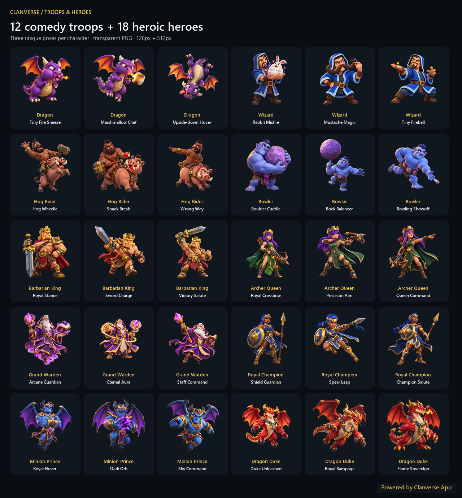

# Clanverse — Comedy Troops & Heroic Heroes

**30 individual stickers: three poses for each of ten characters.**

Created for [Clanverse App](https://clanverse.vercel.app), an unofficial Clash of Clans fan app currently in development. This collection extends the original Archer and Barbarian expression pack without changing its mappings.

## Comedy troop stickers

These are visual comedy situations and exaggerated poses, rather than a repeated happy/sad/crying expression set.

| Character | Sticker 1 | Sticker 2 | Sticker 3 |
| --- | --- | --- | --- |
| Dragon | Tiny Fire Sneeze | Marshmallow Chef | Upside-down Hover |
| Wizard | Rabbit Misfire | Mustache Magic | Tiny Fireball |
| Hog Rider | Hog Wheelie | Snack Break | Wrong Way |
| Bowler | Boulder Cuddle | Rock Balancer | Bowling Showoff |

## Heroic hero stickers

These use powerful, dignified hero poses, recognizable base-character designs, and signature equipment rather than comedy expressions.

| Hero | Sticker 1 | Sticker 2 | Sticker 3 |
| --- | --- | --- | --- |
| Barbarian King | Royal Stance | Sword Charge | Victory Salute |
| Archer Queen | Royal Crossbow | Precision Aim | Queen Command |
| Grand Warden | Arcane Guardian | Eternal Aura | Staff Command |
| Royal Champion | Shield Guardian | Spear Leap | Champion Salute |
| Minion Prince | Royal Hover | Dark Orb | Sky Command |
| Dragon Duke | Duke Unleashed | Royal Rampage | Flame Sovereign |

The Home Village roster was checked against [Supercell's hero reference](https://support.supercell.com/clash-of-clans/en/articles/about-heroes-pets-9.html). This collection does not include Builder Base heroes.



## Files and integration

Each character directory contains three stickers, each with a native-resolution `-master.png`, a transparent 512 × 512px `-512.png`, and a transparent 128 × 128px `-128.png`. The full source folder contains 90 active character PNGs, plus retained legacy compatibility exports where present. Masters retain the generator's native dimensions, which are recorded in `validation.json`.

`manifest.json` contains ten packs and `total: 30`. Each pack has `id`, `name`, `category`, `dir`, `format`, `thumbSuffix`, `fullSuffix`, and `items`. The categories are `comedy` and `heroic`. Per-character `*-pack.json` files mirror their manifest entries. For each item, `file` is a bare stem, `id` is the pose identity, `name` is the character-qualified label, `keywords` supports search, `alias` is a proposed custom token, and `fallback` is a Unicode fallback.

Resolve images with `{assetBase}/{pack.dir}/{item.file}{pack.thumbSuffix}` or `{assetBase}/{pack.dir}/{item.file}{pack.fullSuffix}`. For example, `dragon/01-tiny-fire-sneeze-128.png` is a picker thumbnail. The parent Clanverse app checkout registers these packs in its shared web and Flutter emoji catalogs. Run `python assets/clanverse-character-emojis/sync-app-stickers.py` from the app repository root after rebuilding or correcting artwork to refresh the web previews, Flutter bundles, backend-served files, and registry blocks. Other apps must register the pack entries in their own catalogs.

`sticker-plan.json` records every character, pose, filename stem, and exact generation prompt. The images were created with the built-in image generation tool, not drawn by the export script. `validation.json` records each master dimension, alpha extrema, SHA-256 hash, and export sizes. `generation-state.json` records the completed scope and master file inventory.

## Rebuild and packaging

From this directory, with Python 3.10 or newer:

```powershell
python -m pip install -r requirements.txt
python build-pack.py
```

The script requires all 30 masters. It trims fully empty alpha margins, fits the complete visible artwork within 88% of each 128px/512px square using Lanczos resampling, and leaves at least 6% clear padding per side. It rebuilds ten pack registries and the manifest, creates the labeled aggregation preview, and verifies the ZIP before replacing it. The script preserves all master files and never watermarks individual sticker images. Only `complete-preview.png` receives the semi-transparent **Powered by Clanverse App** corner tag.

`Clanverse-Troops-Comedy-Heroes-30.zip` includes the runtime PNGs, mapping/validation/prompt files, preview, documentation, license, dependency file, and build script. Masters are available in the source folder and are omitted from the runtime ZIP; obtain them to rebuild exports. Keep this collection separate from `Clanverse-Archer-Barbarian-48.zip`.

The corrected Bowling Showoff uses a versioned filename (`03-bowling-showoff-v2`) to refresh cached picker images while retaining the stable `emoji:bowler:bowling-showoff` message ID. Its earlier export filenames are retained as compatibility aliases containing the corrected pixels, including in the runtime ZIP and app asset folders.

## License & Disclaimer

See the unified `LICENSE` distributed with this collection. Python tools are licensed under MIT. Contributor-owned artwork and non-code content use CC BY-NC 4.0, subject to the license's attribution and noncommercial conditions. These grants do not grant Supercell's copyrights, trademarks, endorsement, or permission for character adaptations. Verify any permission required under [Supercell's Fan Content Policy](https://supercell.com/en/fan-content-policy/) before publication.

> This content is not affiliated with, endorsed, sponsored, or specifically approved by Supercell and Supercell is not responsible for it. For more information see Supercell’s Fan Content Policy: ://supercell.com.

Working policy link: [Supercell Fan Content Policy](https://supercell.com/en/fan-content-policy/).

Suggested attribution: **Clanverse Character Stickers by Alok Prasad — CC BY-NC 4.0.** Include the original repository/release URL, the [license link](https://creativecommons.org/licenses/by-nc/4.0/), retained notices, and a description of changes when sharing. The preview's promotional tag does not replace attribution.
